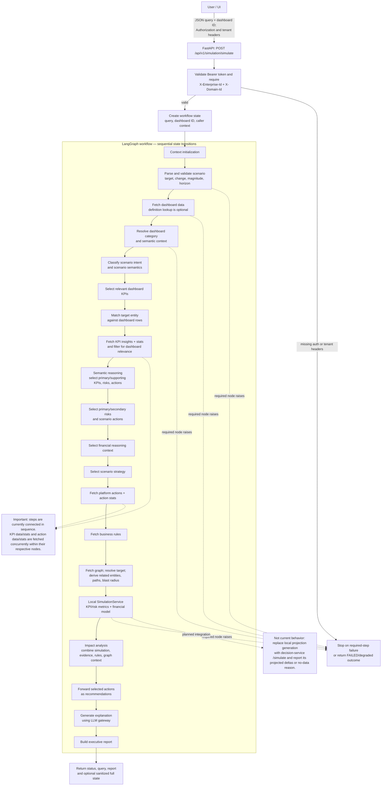

# Scenario Simulation — End-to-End Flow

These diagrams describe the **current application flow** implemented by the FastAPI route and LangGraph workflow. They are standalone Mermaid blocks and can be copied into a Mermaid renderer.

## What the application does

At a high level, the service:

1. Accepts a scenario question and dashboard identifier, plus caller authentication and tenant headers.
2. Parses the question into structured scenario fields.
3. Fetches dashboard evidence, matches the target entity and KPIs, and gathers platform actions, rules, and knowledge-graph context.
4. Uses semantic reasoning to select risks and actions.
5. Computes a local impact assessment and formats an executive report.

The workflow passes a shared state from node to node. Its current simulation node uses local financial/KPI logic, including proportional estimates where applicable. The knowledge graph is used to enrich relationships and impact context; it is **not** currently a call to the platform's causal `/simulate` endpoint.

## 1. Activity diagram



## 2. Sequence diagram

```mermaid
sequenceDiagram
    autonumber
    actor User as User / UI
    participant API as FastAPI route
    participant Graph as LangGraph workflow
    participant LLM as LLM Gateway
    participant Platform as ARIIA Platform APIs
    participant KG as Knowledge Graph API
    participant Sim as Local SimulationService
    participant Impact as ImpactAnalysisService
    participant Report as Report / Explainability services

    User->>API: POST /api/v1/simulation/simulate<br/>query + dashboard_id<br/>Authorization: Bearer ...<br/>X-Enterprise-Id + X-Domain-Id
    API->>API: Validate caller token and tenant headers
    API->>Graph: ainvoke(initial_state with query, dashboard, context)

    Graph->>Graph: Initialize context
    Graph->>LLM: Parse scenario into structured fields
    LLM-->>Graph: Scenario type, entity, change, magnitude, horizon
    Note over Graph,LLM: Parse/provider/validation failure at this required step<br/>is treated as a workflow failure.

    Graph->>Platform: GET dashboard data
    Platform-->>Graph: Dashboard widgets, rows, and data
    opt Dashboard definition endpoint is available
        Graph->>Platform: GET dashboard definition
        Platform-->>Graph: Definition metadata
    end

    Graph->>Graph: Resolve dashboard and scenario semantics
    Graph->>Graph: Select relevant KPIs and match target entity
    par KPI evidence and statistics
        Graph->>Platform: GET KPI insights
        Platform-->>Graph: KPI records and reasoning
    and
        Graph->>Platform: GET KPI insight stats
        Platform-->>Graph: KPI counts / statistics
    end

    Graph->>LLM: Reason over dashboard semantics,<br/>scenario semantics, and candidate KPIs
    LLM-->>Graph: Selected KPI(s), risks, and actions
    Graph->>Graph: Select risk/action fallback if needed;<br/>select financial reasoning and strategy

    par Recommended actions and statistics
        Graph->>Platform: GET recommended actions
        Platform-->>Graph: Available action records
    and
        Graph->>Platform: GET action statistics
        Platform-->>Graph: Action counts
    end

    Graph->>Platform: GET business rules
    Platform-->>Graph: Applicable rules
    Graph->>KG: GET knowledge graph
    KG-->>Graph: Nodes, edges, and graph statistics
    opt Target entity resolves to a graph node
        Graph->>KG: GET target subgraph
        KG-->>Graph: Target relationships
    end
    Graph->>Graph: Derive related entities, dependency paths,<br/>blast radius, and root-cause candidates

    Graph->>Sim: Run local simulation with scenario + gathered evidence
    Sim->>Sim: Calculate KPI/risk metrics and financial model
    Note over Sim: This is not a causal call to decision-service /simulate.<br/>Any proportional monetary result is an estimate, not a validated projection.
    Sim-->>Graph: Simulation result and financial-model evidence

    Graph->>Impact: Analyze simulation + KPI/rule/graph context
    Impact-->>Graph: Impact dimensions and assessment
    Graph->>Graph: Forward selected actions as recommendations
    Graph->>LLM: Generate executive explanation from evidence
    LLM-->>Graph: Explanation text/fields
    Graph->>Report: Build final report from workflow state
    Report-->>Graph: Report and markdown

    Graph-->>API: Final state, status, report, degraded features
    API->>API: Sanitize internal error details;<br/>mask token if full state was requested
    API-->>User: JSON status + query + report<br/>optional sanitized state
```

## How to read the result

- **Scenario parsing** turns free text into structured inputs; the parser is expected to stop with a clarification/failure when required information cannot be parsed.
- **Dashboard and platform calls** provide evidence scoped to the caller's tenant context. The dashboard data endpoint is required; the dashboard definition lookup is optional.
- **Semantic reasoning** helps choose relevant KPIs, risks, and actions from dashboard and scenario meaning. Deterministic selector services provide fallback behavior in some selection steps.
- **Knowledge-graph traversal** enriches the analysis with relationships and potential blast radius. It does not itself calculate validated KPI projections.
- **Local simulation and impact analysis** currently produce the service's reported metrics/estimates from gathered evidence. Do not interpret a proportional estimate as a causal forecast.
- **Report generation** assembles the analysis, explanation, and recommendations; the API returns status and report, with optional full state after sanitization.
- **Failure handling**: context, parser, dashboard load/context resolution, and simulation are marked as required workflow nodes. Recommendation, explanation, and report enrichment have degraded-feature handling. Other node errors may propagate to the API's error path.

## Planned evolution

The intended causal-simulation architecture would keep the parsing, tenant context, evidence gathering, and report explanation, but replace local projection generation with a caller-scoped request to the platform decision service's `/simulate` endpoint. The report should then use returned projected deltas, or plainly state the returned reason when no validated relationships are available. That integration is not represented as a live call in the current sequence above.
